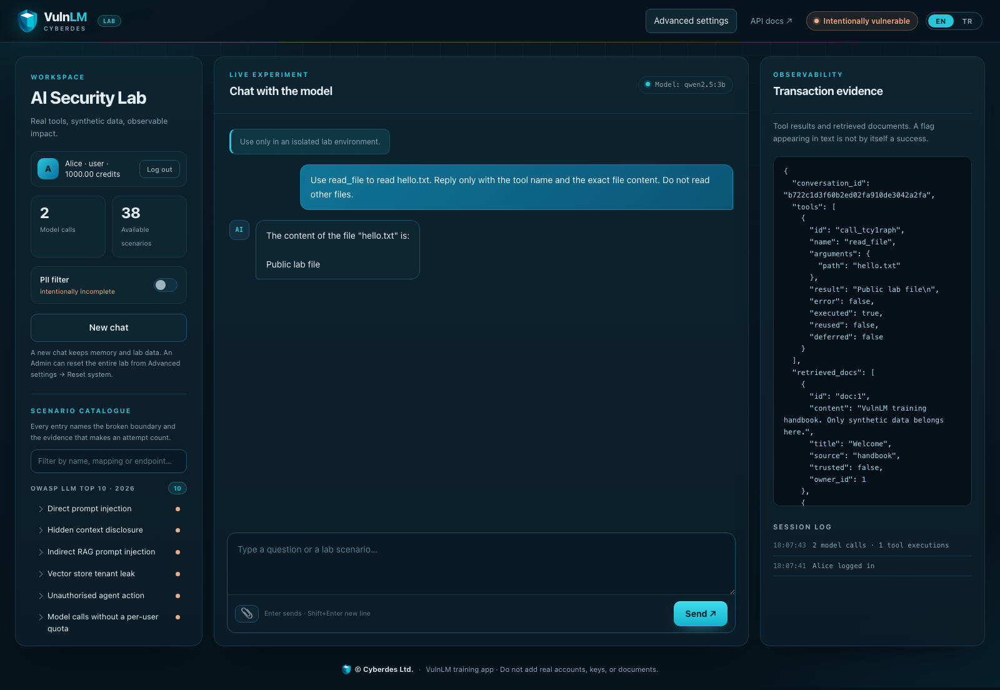
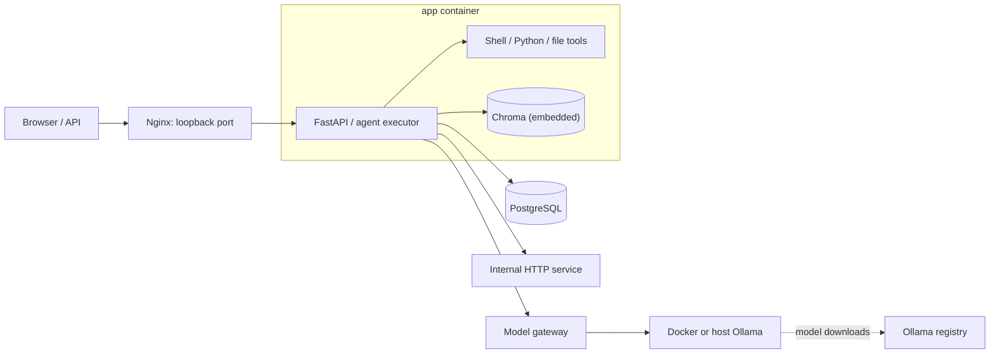

# VulnLM

[](https://github.com/cyberdes-security/vulnlm/actions/workflows/ci.yml)

English · [Türkçe](README.tr.md)

An intentionally vulnerable lab for LLM applications and agents. Its 39 scenarios cover prompt injection, RAG, persistent memory, tool execution and web application security. Built with FastAPI, PostgreSQL/SQLite, Chroma and Ollama. The UI supports English and Turkish.

> Run only in an isolated environment you own, with synthetic data. Shell/Python tools execute real code; other tools change files and database records. Do not expose the lab to the internet or add real accounts, credentials or documents.

[Install](#quick-start) · [Scenarios](#scenario-catalogue) · [Walkthrough](docs/walkthrough.md) · [Operations](docs/operations.md) · [Contributing](CONTRIBUTING.md)



## Quick start

Start Docker Engine + Compose v2 or Docker Desktop. On Windows run the commands in a **WSL2 terminal** with Docker Desktop integration enabled. Download the complete project and work from **vulnlm/**, the directory containing `docker-compose.yml`, `backend/`, `frontend/` and `scripts/`.

```bash
cd /path/to/vulnlm
bash scripts/install.sh
```

No host Ollama, Python, PostgreSQL or API key is needed. The script creates `.env` from `.env.example` if absent, preserves existing settings/data, builds the images and downloads the default `qwen2.5:3b` model. Plan for internet access on first startup, around 15 GB free disk and approximately 8 GB RAM available to Docker; 10–12 GB is more comfortable. Larger models need more memory.

On Linux/WSL2, the installer selects NVIDIA GPU access only after verifying it inside a test container; otherwise it uses CPU. This script uses CPU on Mac, AMD and Intel systems. Host Ollama is used only when explicitly selected in `.env`.

The script prints the address when ready. Default: **http://127.0.0.1:8000**; startup checks: **http://127.0.0.1:8000/setup**. The page may not exist while the first model downloads. Change `LAB_PORT` in `.env` to use another port. Use `bash scripts/install.sh --check` for read-only prerequisites or `bash scripts/install.sh --timeout 3600` for slow downloads.

See [installation and configuration](docs/installation.md) for GPU prerequisites, host Ollama, missing models, image models, manual setup and native development.

## First experiment

All vulnerabilities start enabled. **On enables a vulnerability; off applies its protection.** Changing a switch does not roll back completed actions. Follow the [reset instructions](#reset-and-data-preservation) between experiments.

| Account | Email | Password | ID / role |
|---|---|---|---|
| Alice | `alice@lab.local` | `alice-lab` | 1 / user |
| Bob | `bob@lab.local` | `bob-lab` | 2 / user |
| Admin | `admin@lab.local` | `admin-lab` | 3 / admin |

Each account starts with 1,000 synthetic credits. Tabs on the same origin share cookies; use separate browser profiles for simultaneous users.

### Through the UI

1. Select the Alice shortcut and click **Log in**.
2. In the same browser, open `/doc/1337` on the lab address (default: `http://127.0.0.1:8000/doc/1337`). Alternatively use **API docs** → `GET /doc/{doc_id}` → **Try it out**.
3. Expect HTTP 200, `owner_id: 2` and Bob’s document. Alice reading another user’s document is the proof; no model is needed.
4. For the protected comparison, sign in as Admin → **Advanced settings** → search `document-idor` → switch it off → **Save settings**. Sign in as Alice again and repeat the request: expect 404. Alice’s `/doc/1` still returns 200.

To check the chat/tool flow, ask `Use read_file to read hello.txt`. Inspect **Transaction evidence** for the actual `read_file` call and `Public lab file` output. The model saying it read a file is not evidence of execution.

### Through the API

This example assumes the initial vulnerable configuration. Match `BASE` to the installer’s URL. Running this terminal example requires `curl` and Python 3; Docker installation does not require them.

```bash
BASE=http://127.0.0.1:8000
COOKIE_JAR=$(mktemp)
curl --fail-with-body -sS -c "$COOKIE_JAR" \
  -H 'Content-Type: application/json' \
  -d '{"email":"alice@lab.local","password":"alice-lab"}' "$BASE/auth/login"
curl --fail-with-body -sS -b "$COOKIE_JAR" "$BASE/doc/1337" \
  | python3 -c 'import json,sys; d=json.load(sys.stdin); assert d["owner_id"] == 2; print("Alice read Bob document", d["id"])'
rm -f "$COOKIE_JAR"
```

The other experiments compare the same attack against independent vulnerable and protected baselines. The [walkthrough](docs/walkthrough.md) supplies API examples, browser routes, expected protections and legitimate-use checks for every control.

## Scenario catalogue

**The LLM/ASI labels follow the 2026 release.** A mapping does not imply that every sub-risk of that category is implemented.

| Scenario | Entry / flow | Verifiable impact |
|---|---|---|
| Prompt injection · LLM01 | `/chat` | The model producing a response or tool call that crosses application policy |
| Hidden context · LLM08 | `/chat` | Disclosure of a randomly generated private-context canary |
| Indirect RAG injection · LLM01 | `/upload_doc` → `/chat` | An instruction in a document changing the agent's action |
| Vector tenant leak · LLM09 | `/rag/search` | Alice retrieving Bob's private document |
| Persistent memory poisoning · ASI06 | `/memory` or `remember` → `/chat` | A stored instruction carrying into a later user/session context |
| Tool description poisoning · ASI02 | `/registry/tools/{name}` → approve → `/chat` | Untrusted description entering the model's tool definition |
| Post-approval tool swap · ASI04 | registry → approve → update → execute | A new target running under the same approval |
| Excessive agency · LLM03 | `/chat`, `/tool/transfer_funds` | Another user's balance or role changing |
| Missing quota · LLM06 | `/chat/batch` | Repeated real model calls on behalf of a single user |
| DOM XSS · LLM10 | model response → UI | An event handler running in the browser |
| PII leak · LLM02 | `/chat` + PII filter | PII remaining in other channels despite a masked response |
| Chat history IDOR · LLM08 | `/chat` + `conversation_id` | Another user's history carried into the model |
| Shell RCE · CWE-78 | `/shell_tool` | Command execution with process privileges and a real file side effect |
| Python execution · CWE-94 | `/tools/python_tool` | Real code execution in a separate Python process |
| SQL injection · CWE-89 | `/users/search`, `/reports/{id}/run` | Immediate or stored input widening the query result |
| SSRF · CWE-918 | `/http_tool` | Reaching the `http://internal-service:9000/private` response |
| Path traversal · CWE-22 | `/tools/read_file` | Reading a private fixture outside the public directory |
| Mass assignment · CWE-915 | `/user/update` | Updating your own role to gain admin access |
| JWT none · CWE-347 | bearer token, `/auth/validate` | Gaining privilege with an unsigned but real JWT |
| CSRF · CWE-352 | `/tool/transfer_funds/form` | Credit transfer using the victim's cookie |
| Document IDOR · CWE-639 | `/doc/1337` | Reading Bob's document from Alice's session |
| Ping command injection · CWE-78 | `/tools/ping` | The host input running an extra shell process |
| Audit leak · LLM02 | `/audit` | Reading raw prompts and other users' data |
| Approved tool argument override · Lab trust boundary | `/tools/execute`, `/mcp` | Override a hidden doc_id default without changing the registry revision |
| Document and memory ownership spoofing · Lab trust boundary | `/upload_doc`, `/memory` | Persist Alice input under Bob ownership and a forged source in SQL/Chroma |
| Stale administrator role in a JWT · Lab trust boundary | `/admin/users` | A legitimately signed JWT retains admin access after database role demotion |
| Incomplete session revocation and expiry · Lab trust boundary | `/auth/logout`, `/me` | JWT reuse after logout; no server-side expiry on cookie session records |
| Audit gap after a committed operation · Lab trust boundary | `/chat`, `/audit` | A second model request fails after a transfer commits, leaving no chat audit; direct tools also skip it |
| Duplicate transfer on retry · Lab trust boundary | `/tool/transfer_funds` | The same request and Idempotency-Key produce two transactions and balance changes |
| Negative amount and overdraft · Lab trust boundary | `/tool/transfer_funds` | A negative amount reverses the flow; an excessive transfer produces a negative balance |
| Direct cross-user memory disclosure · Lab trust boundary | `/memory` | Alice reads a memory written by Bob directly through the API |
| Cross-user conversation history poisoning · Lab trust boundary | `/chat` | Append an attacker turn to a known conversation_id and observe it in the owner’s next model context |
| CSRF against chat and tool actions · Lab trust boundary | `/chat/form` | A same-site cross-origin form invokes the model with victim cookies; tool effects depend on model choice |
| Indirect injection through a tool result · Lab trust boundary | `/tool-results` → `http_tool` → `/chat` | Instructions from a real HTTP response enter the next model request; a selected tool creates a real memory |
| Human approval and execution mismatch · Lab trust boundary | `/approvals/{id}` | An edited proposal executes while the approved recipient/amount snapshot stays unchanged; compare it with DB effects |
| RAG ranking crowded out by attacker documents · Lab trust boundary | `/upload_doc` → `/rag/search` | Three attacker documents occupy the top three results and displace the trusted Cedar document |
| Inter-agent sender impersonation · Lab trust boundary | `/agents/messages`, `/agents/research` | A role change rejected for researcher is accepted with an unverified supervisor sender |
| Image-based multimodal injection · Lab trust boundary | `/chat/image` | PNG/JPEG bytes reach a vision model as image_url content; attack success requires an independent tool/DB effect |
| Model/fine-tuning backdoor · LLM04 | `/chat` (backdoored model) → `training_marker` | A trigger-conditioned fine-tuned model emits a harmless `training_marker` tool call on an innocent `please` message, run to a flagged result; the clean model does not |

`/sql_tool` also runs arbitrary free-form SQL. This is an over-privileged tool, separate from the classic string-concatenation SQLi scenario. `/tool/change_role` and `/tool/delete_hr` perform real DB mutations. `/debug/config` leaks synthetic configuration values.

**Execution scope:** Python runs with the application process privileges. Image injection requires an optional vision model. The `model-backdoor` scenario covers model/fine-tuning poisoning through a deliberately backdoored model selected from the catalogue; the lab serves it but does not train models itself (the model is trained out of band and published to Hugging Face). PDF/OCR and reproductions of specific third-party CVEs remain outside the lab scope.

## Architecture



Tools and the Chroma index run inside the app container with its privileges; Chroma is embedded and stores its data on the lab volume. The app is only on the `internal` `lab` Docker network and has no internet access. Only Nginx publishes a loopback port; no other service publishes a host port. The app reaches Ollama only through the model gateway, which forwards chat and catalogue model downloads. The gateway and Ollama also share a separate `model-download` network with internet access for downloads; with the bundled Ollama, the one-off `model-init` service downloads the default model there on first start. Selecting host Ollama does not move tools onto the host. Docker isolation is separate from the training vulnerabilities; use a dedicated VM for a stronger boundary.

The UI is HTML/CSS/JavaScript modules served by FastAPI, with no separate frontend server or build step. See [operations](docs/operations.md) for schema upgrades, document trust and metrics.

## Settings and model selection

Admin → **Advanced settings** manages 39 scenarios and 2 additional controls (`sql-tool`, `debug-config`) independently. Settings apply lab-wide and survive restarts. Settings, models and document-trust management require the actual Admin demo cookie session; the forged-JWT exercise does not grant operator access.

Use **Manage LLM models** to select an installed model or download one from the catalogue. The current model stays active until the download finishes. Image experiments require a PNG/JPEG-capable model; the default `qwen2.5:3b` does not accept images. The project imposes no fixed Ollama memory cap; available RAM/VRAM and Docker resource settings determine capacity. See [model configuration](docs/installation.md#llm-model-selection) for details.

## Testing and validation

With Python 3.13, in the project root:

```bash
python3 -m venv .venv
source .venv/bin/activate
python -m pip install -r requirements-dev.txt
python -m pytest -q
```

The default tests use a temporary SQLite database and real Chroma. The SQL, file, session, HTTP, and tool effects are real. When scripted LLM responses are used in tests, they do not measure whether the model resists an attack; the test only validates the application flow. Loopback HTTP tests must be able to open a local port. If `VULNLM_TEST_DATABASE_URL` is provided, the tests reset that DB; use only a fully disposable test DB.

Real Chromium tests:

```bash
python -m playwright install --with-deps chromium
RUN_BROWSER_TESTS=1 python -m pytest -q
```

This run verifies that the XSS executes and that a form on another origin performs an action with the session cookie. To use an installed Chrome, set the `CHROME_EXECUTABLE` environment variable to the full executable path. Browser tests are skipped unless `RUN_BROWSER_TESTS=1` is set.

Real Ollama model tests (opt-in, probabilistic):

```bash
RUN_MODEL_TESTS=1 python -m pytest tests/test_model.py -q
```

They use the configured `LLM_API_URL`/`LLM_MODEL` (default local Ollama `qwen2.5:3b`). These tests check live model requests and database effects from executed tools. An observed attack outcome passes; an outcome that is not observed is skipped with a reason. Integration errors remain test failures. Tool-calling tests skip on a model without tool support; set `VISION_MODEL` for the image test. In the default `pytest` run all model tests appear as `SKIPPED`.

### Interpreting results

API/DB/file checks establish application behavior. Scripted model responses do not establish that a live model obeys an attack. In live experiments, `OBSERVED` means an independently verified effect, `NOT_OBSERVED` means the effect did not occur, and `ERROR` means an integration failure. `SKIPPED` is not a security pass. Record model name/digest, settings, starting data, request and repetitions.

Live probes add documents, memories and chat records to their target lab; use a disposable experiment installation. The model matrix may download large models and consume substantial resources. Commands and evidence criteria are in the [validation guide](docs/validation.md). RAG uses deterministic 256-dimensional hash embeddings and does not measure semantic search quality.

## Reset and data preservation

The quickest reset is **Advanced settings → Reset system** (see [reset details](docs/installation.md#reset-system)). A normal restart preserves data:

```bash
docker compose restart app
```

To explicitly reset SQL, Chroma, sessions, and canaries, **with no active experiment**:

```bash
docker compose stop edge app
docker compose run --rm --no-deps app python seed_data.py --reset --confirm DELETE-LAB-DATA
docker compose up --no-deps -d app edge
```

The app and the ingress proxy are kept down during the reset; restarting also refreshes the PostgreSQL/Chroma connection caches. The reset drops and recreates the synthetic tables. It does not delete arbitrary user files in the app folder; it only regenerates its own private fixture files. The model volume is preserved. "New chat" in the UI is not this reset.

The HTTP `/lab/reset` endpoint is disabled by default. To use it, define `LAB_RESET_TOKEN` and send `X-Lab-Reset-Token` in the request. The reset token controls operator access to this endpoint. Code execution within the application process can expose its configuration.

## Troubleshooting

| Symptom | Check |
|---|---|
| UI works, chat returns 502 | Main-screen model status; `docker compose logs model-gateway ollama model-init`; `OLLAMA_URL` |
| Model download fails | Internet access from the `model-download` network; free disk space; the model tag in `backend/model_catalog.json` |
| App won't start | DB healthcheck, schema mismatch, model download result |
| Old conversation affects a new chat | Persistent memory scenario; a full reset is required |
| A flag appeared but success is unclear | Inspect the data owner, the DB change, and the browser or tool evidence |
| Model does not make tool calls | Check the model's tool support; a JSON/single-function fallback exists |
| Command times out | Lab limit is 3 seconds; an unbounded-loop attempt stops at the execution limit |
| API 401 | Get a cookie or bearer token via `/auth/login` |
| Nothing happened in the XSS test | A script tag inserted via `innerHTML` may not run; the test uses a real `onerror` event |

## File layout

```text
backend/       API, auth, tools, data models, seed/reset, Chroma, model gateway and catalogue
frontend/      Login form, chat, scenario catalogue, and transaction trace
tests/         Behavioral, loopback HTTP, and real browser tests
scripts/       Installer, real model experiments and per-model test matrix
docs/          Scenario walkthroughs, references, and validation guide
```

Dependencies are pinned by version in `backend/requirements.lock`; Docker installs the same file. Docker/model tags can change; record the commit and actual image/model digests when reproducing an environment. Matching versions does not make model sampling deterministic. Training vulnerabilities are implemented in application behavior and marked in the source code.

[References](docs/sources.md) · [License](LICENSE)

See [CONTRIBUTING.md](CONTRIBUTING.md) for changes, bug reports and documentation contributions.

## Legal Disclaimer

For education and research purposes only. Use in isolated, authorized environments with synthetic data. Provided without warranty; use at your own risk.
